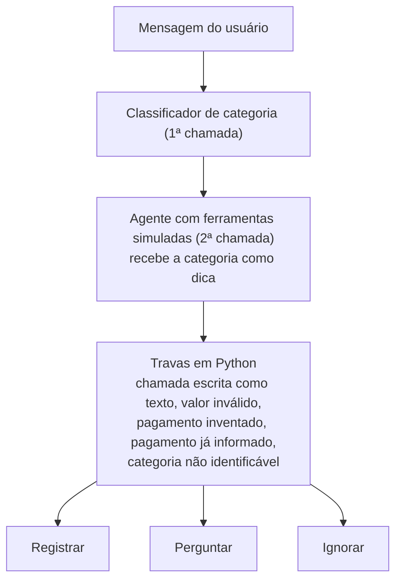

# Benchmark próprio de agentes de IA

Conjunto de avaliações em Python para medir a **eficácia** e a **eficiência** de um agente de IA e comparar suas versões **com dados**, e não por impressão. Tudo roda em casa, em um modelo local e gratuito.

O primeiro alvo é um agente que lê mensagens de gastos e decide entre registrar, perguntar o que falta ou ignorar. Em 15 versões, medidas uma mudança por vez, ele foi de **25/45 para 44/45** nos casos de ajuste.

| Medida | Linha de base (v1) | Versão atual (v15) |
|---|---|---|
| Acertos nos casos de ajuste | 25/45 (56%) | **44/45 (98%)** |
| Acertos quando deveria perguntar | 1/15 (7%) | **15/15 (100%)** |
| Conjunto oculto (validação final) | não medido | **15/15** |
| Tempo médio por mensagem | 3,1 s | 5,4 s |
| Tokens médios por mensagem | 1513 | 2808 |

A melhora teve um preço: cerca de 77% mais tempo e 86% mais tokens por mensagem. Os números da v15 valem para o Ollama 0.40.4, e os limites do resultado estão [mais abaixo](#limites).

## O agente medido

O agente transforma uma mensagem em uma de três ações, usando ferramentas simuladas:

| Mensagem | Decisão esperada |
|---|---|
| `Gastei 35 no mercado no pix` | **registrar**: valor 35, categoria mercado, pagamento pix, data de hoje |
| `Almoço 22` | **perguntar**: falta a forma de pagamento |
| `Bom dia! Tudo certo?` | **ignorar**: não é um gasto |

A regra central é que o agente **pergunta em vez de assumir**. O benchmark mede só essa interpretação e nunca grava no Notion nem envia mensagens pelo Telegram. As regras completas estão em [especificacao-agente.md](especificacao-agente.md).

- **Modelo:** `qwen3:4b-instruct`, local, pelo Ollama.
- **Hardware:** 16 GB de RAM e GTX 1650 de 4 GB.
- **Custo:** nenhum; não há chamada a API paga.

Na v15, cada mensagem passa por duas chamadas ao modelo e por travas em Python, que corrigem erros já conhecidos do modelo:



## Como o benchmark mede

- **Casos com gabarito:** 15 casos de ajuste em [casos/casos.json](casos/casos.json) e 5 ocultos, reservados para a validação final. São sintéticos e têm dificuldades variadas.
- **Três execuções por caso:** cada caso roda uma vez em cada ordem dos exemplos do prompt (original, invertida e girada). Só reordenar os exemplos já mudou o placar da v2 de 25 a 31/45, então uma execução única poderia premiar a sorte.
- **Tipo de erro:** cada falha é classificada como `formato`, `acao` ou `campos`, o que separa "não entendeu" de "entendeu e respondeu fora do formato".
- **Uma mudança por vez:** cada versão altera uma única coisa no agente, para que o efeito possa ser atribuído a ela.
- **Registro completo:** cada execução vai para [resultados/resultados.csv](resultados/resultados.csv), e as respostas cruas, para `resultados/brutos_*.json`. Assim, uma ideia nova pode ser simulada nas respostas salvas antes de rodar o modelo.

### A régua de aprovação

A soma de acertos não decide sozinha. [comparar_versoes.py](comparar_versoes.py) compara as versões caso a caso, com uma de três réguas, escolhida **antes** de rodar:

| Régua | Quando usar | Para aprovar |
|---|---|---|
| Normal | Mudança com ganho esperado | 0 perdas de casos estáveis, pelo menos 2 ganhos e total que não cai |
| Neutra | Trava que implementa uma regra explícita | 0 perdas e total que não cai |
| Dirigida | Mudança que mira um caso declarado | 0 perdas, total que não cai e o caso-alvo subindo pelo menos 2 ordens |

Se a régua apontar a perda de um caso que a mudança não tocou, a versão base é repetida no mesmo dia. Se a base errar da mesma forma, a perda é tratada como ruído.

## Resultados

| Versão | O que mudou | Acertos | Tempo | Tokens | Decisão |
|---|---|---|---|---|---|
| v1 | Agente mínimo (3 execuções na ordem original) | 25/45 | 3,1 s | 1513 | linha de base |
| v2 | Bloco de 8 exemplos resolvidos no prompt | 31/45 | 2,9 s | 1804 | adotada |
| v3 | Exemplos como conversa com chamadas reais | 27/45 | 2,8 s | 1956 | reprovada |
| v4 | v2 + recuperação da chamada escrita como texto | 34/45 | 3,2 s | 1804 | aprovada |
| v5 | v4 + regra para deduzir a categoria | 36/45 | 3,3 s | 1897 | reprovada |
| v6 | v4 + regra de categoria restrita | 38/45 | 3,8 s | 2075 | reprovada |
| v7 | v4 + trava do valor inválido | 34/45 | 3,6 s | 1804 | aprovada |
| v8 | v7 + regra de categoria | 40/45 | 3,4 s | 2075 | reprovada |
| v9 | v7 + trava do pagamento já informado | 34/45 | 3,5 s | 1804 | aprovada |
| v10 | v9 + regra de categoria | 41/45 | 3,3 s | 2075 | aprovada |
| v11 | v10 + mais vocabulário nas categorias | 42/45 | 4,1 s | 2261 | reprovada |
| v12 | v10 + classificador de categoria com trava | 41/45 | 5,6 s | 2781 | aprovada após apurar ruído |
| v13 | v12 + categoria como dica para o agente | 40/45 | 5,6 s | 2808 | reprovada |
| v14 | v12 + trava do pagamento inventado | 41/45 | 5,4 s | 2781 | aprovada |
| **v15** | **v14 + dica religada** | **44/45** | **5,4 s** | **2808** | **aprovada** |
| v15, conjunto oculto | Validação final, sem ajustes | 15/15 | 6,7 s | 2792 | concluída |

O caso C08 teve a redação alterada em 16/10 para retirar uma gíria, então o resultado desse caso de v1 a v5 não é estritamente comparável com o das versões seguintes.

### O que os dados corrigiram

**1. A nota mais alta nem sempre venceu.** A v6 (38/45) e a v8 (40/45) somavam mais que a base da época (34/45), mas foram reprovadas por perder o caso C10. Ao deduzir a categoria, o agente passava a escrever registros com valor 0 ou a pedir um pagamento já informado. A solução veio em duas travas, testadas separadamente, e só então a regra de categoria entrou, na v10. Essa versão chegou a 41/45 sem perdas.

**2. Uma instrução no prompt não bastou; uma trava em Python, sim.** Na v13, ao receber a categoria como dica, o agente inventava a forma de pagamento, mesmo com o limite escrito no texto. Uma simulação nas respostas salvas previu que uma trava levaria o placar de 40 para 44/45. A trava foi aprovada sozinha pela régua neutra (v14), a dica foi religada (v15), e o resultado foi exatamente 44/45. A v15 ainda inventa o pagamento, e a trava o corrige.

**3. O ambiente faz parte do experimento.** Uma atualização automática do Ollama, da 0.40.4 para a 0.40.13, fez a mesma v15, com o mesmo código e o mesmo modelo, variar de 41 a 44/45. Nessa versão, a régua neutra chegou a reprovar a v15 contra ela mesma. Por isso, o benchmark foi fixado na 0.40.4 e [para com um aviso](ambiente.py) se o servidor estiver desligado ou em outra versão.

## Testando a própria régua

Um benchmark também pode estar errado, então ele passou por um [teste de mutação](resultados/analise_mutacao_2026-10-30.md): falhas colocadas de propósito para ver se seriam percebidas. Pense em um alarme de incêndio testado com fumaça de verdade.

| O que foi alterado | Resultado |
|---|---|
| Respostas certas da v15 corrompidas (15 tipos) | 12 tipos detectados em 100% das respostas |
| Código do próprio benchmark (23 mutantes) | 8 lacunas encontradas e corrigidas; só sobrevive 1 mutante, equivalente ao original |
| Agente com uma peça removida (8 mutantes, com o modelo) | 5 detectados |

As falhas não detectadas viraram limites conhecidos, listados a seguir.

## Limites

- **A amostra é pequena.** São 15 casos de ajuste e 5 ocultos, todos sintéticos. O 44/45 foi obtido nos casos usados para os ajustes; portanto, não mede a generalização.
- **O 15/15 pede cautela.** São só 5 casos, um deles repete o padrão de um caso de ajuste, e o resultado cairia para 13/15 sem as travas. Ele foi medido uma vez, na 0.40.4. O conjunto oculto já foi usado, então uma nova validação exige casos novos.
- **O erro restante é repetível.** O C08 na ordem invertida ainda pergunta a categoria, mesmo com a dica.
- **Pontos cegos da comparação:** ela não avalia o texto da pergunta, não percebe um campo inventado em um registro e não distingue uma conversa de uma mensagem ignorada.
- **Regras que os casos não cobrem:** os casos de ajuste não medem a regra "o que não é gasto" e não acionam, na v15, a recuperação de texto (v4) nem a trava do pagamento informado (v9).
- **Estabilidade:** a da 0.40.4 vem de 3 repetições em um dia, e essa versão também teve ruído (caso C09, na v12).
- **Escopo:** o agente mede só a interpretação; não há integração com o Telegram nem com o Notion.

## Como rodar

Requer Windows, Python 3.14 e, para rodar o modelo, o Ollama 0.40.4.

```powershell
py -m venv .venv
.venv\Scripts\python -m pip install -r requirements.txt
```

**Sem o modelo:** estes comandos usam só os resultados já salvos.

```powershell
.venv\Scripts\python comparar_versoes.py v14 v15 --alvo C08
.venv\Scripts\python testar_regua.py
.venv\Scripts\python testar_trava_pagamento.py
.venv\Scripts\python testar_dashboard.py
.venv\Scripts\streamlit run app.py
```

O último comando abre o painel no navegador, com duas páginas: **Visão geral** (os gráficos) e **Executar** (confere o ambiente antes de uma execução).

**Com o modelo:**

1. Baixe o zip oficial do [Ollama 0.40.4](https://github.com/ollama/ollama/releases/tag/v0.40.4) para Windows e extraia em `%LOCALAPPDATA%\Programs\Ollama-0.40.4`.
2. Em um terminal separado, ligue o servidor na porta 11500 e deixe a janela aberta:

   ```powershell
   .\iniciar_ollama.bat
   ```

3. Em outro terminal, baixe o modelo por esse servidor e rode o benchmark:

   ```powershell
   $env:OLLAMA_HOST = "127.0.0.1:11500"
   & "$env:LOCALAPPDATA\Programs\Ollama-0.40.4\ollama.exe" pull qwen3:4b-instruct
   .venv\Scripts\python benchmark.py
   ```

**Atalho:** [abrir_benchmark.bat](abrir_benchmark.bat) faz os passos de ligar o servidor e o painel com um duplo clique e abre o navegador.

## Estrutura

| Arquivo | Função |
|---|---|
| [agente.py](agente.py) | O agente: prompt, ferramentas simuladas, classificador e travas |
| [benchmark.py](benchmark.py) | Executa os casos, compara com o gabarito e grava os resultados |
| [comparar_versoes.py](comparar_versoes.py) | Compara duas versões caso a caso e aplica a régua |
| [app.py](app.py) | Ponto de entrada do painel: menu com as páginas |
| [dashboard.py](dashboard.py) | Página "Visão geral": as métricas em Streamlit, lidas só do CSV |
| [app_pages/executar.py](app_pages/executar.py) | Página "Executar": confere o Ollama e o rótulo da versão |
| [.streamlit/config.toml](.streamlit/config.toml) | Tema visual do painel ("Grafite") |
| [abrir_benchmark.bat](abrir_benchmark.bat) | Liga o Ollama e o painel com um duplo clique |
| [ambiente.py](ambiente.py) | Fixa e confere a versão do Ollama |
| [testar_mutacao.py](testar_mutacao.py) | Teste de mutação do benchmark |
| `testar_*.py` | Testes das demais peças |
| [casos/](casos/) | Casos de teste com gabarito |
| [resultados/](resultados/) | CSV, respostas cruas e análises |
| [design/esteticas/](design/esteticas/) | Maquetes das três estéticas avaliadas para o painel |
| [docs/](docs/) | Ideia de uma evolução: o Laboratório de Agentes de Pesquisa |

## O que aprendi

**Avaliar é um método, não uma conferência no fim.** Antes deste projeto, eu julgaria uma versão do agente testando algumas mensagens e olhando as respostas. O benchmark mostrou que essa impressão engana: versões que pareciam melhores perdiam casos que antes acertavam. Aprendi também a escolher o critério de aprovação antes de ver o resultado, porque, depois de ver o número, é fácil ajustar a régua para aprovar a ideia de que gosto.

**Um agente não responde sempre igual.** Mesmo com temperatura 0, só mudar a ordem dos exemplos no prompt mudava o placar. Um caso que eu considerava estável (C09) errou uma das três ordens na v12; a versão anterior, repetida no mesmo dia, errou a mesma ordem do mesmo jeito: não era efeito da mudança, era ruído. Por isso cada caso roda em três ordens, e uma perda inesperada pede uma repetição antes da decisão.

**Cada parte do trabalho vai para quem a faz melhor.** O modelo é bom em interpretar a linguagem; regras exatas, como "não registrar valor 0" ou "não inventar a forma de pagamento", são mais confiáveis em Python. As travas mais úteis nasceram de erros observados nas respostas salvas e foram simuladas nelas antes de rodar o modelo de novo, o que poupou execuções e evitou mudanças às cegas.

**O avaliador também precisa ser avaliado.** O teste de mutação mostrou que o benchmark tinha lacunas que eu não teria percebido, e que alguns casos não cobrem regras importantes. Uma nota só tem valor se o instrumento que a mede foi testado.

**Python na prática.** Comecei o projeto aprendendo a linguagem. Ao longo dele, usei listas e dicionários para representar casos e respostas, funções para separar cada etapa, leitura e escrita de JSON e CSV, expressões regulares para encontrar palavras nas mensagens, argumentos de linha de comando e testes automatizados que conferem cada peça sem chamar o modelo.

## Como este projeto foi construído

Projeto desenvolvido com o apoio do Claude Code, registrado como coautor nos commits.

**Divisão do trabalho.** As decisões foram minhas: as regras do agente na [especificação](especificacao-agente.md), os casos de teste e seus gabaritos, os textos do prompt, escritos em conjunto ou aprovados por mim antes de cada execução, as três réguas de aprovação, que defini ou aceitei, a decisão de aprovar ou reprovar cada versão, o momento de encerrar os ajustes antes de abrir o conjunto oculto e a fixação da versão do Ollama. O Claude Code escreveu boa parte do código a meu pedido, explicou os conceitos de Python à medida que apareciam e propôs análises e simulações, que eu conferi caso a caso antes de aceitar.

**Método.** O trabalho foi feito em etapas pequenas: casos com gabarito, agente mínimo, script do benchmark, linha de base e, depois, uma mudança no agente por versão. Entre 14/10 e 28/10, o benchmark registrou 1155 execuções no CSV, somando as 15 versões, os lotes de calibração e a validação oculta. Desde o segundo dia, as sessões terminaram, em regra, com um bilhete de retomada e uma linha no diário, para que a seguinte começasse do ponto em que a anterior parou.

**Restrições.** Tudo foi feito em casa, sozinho e com ferramentas gratuitas: um modelo de 4B parâmetros rodando localmente em uma GPU de 4 GB, sem nenhuma chamada a API paga. O limite de hardware orientou escolhas, como corrigir erros com travas em Python em vez de trocar por um modelo maior.

## Licença

[MIT](LICENSE): o código pode ser usado e adaptado, desde que o aviso de autoria seja mantido.
